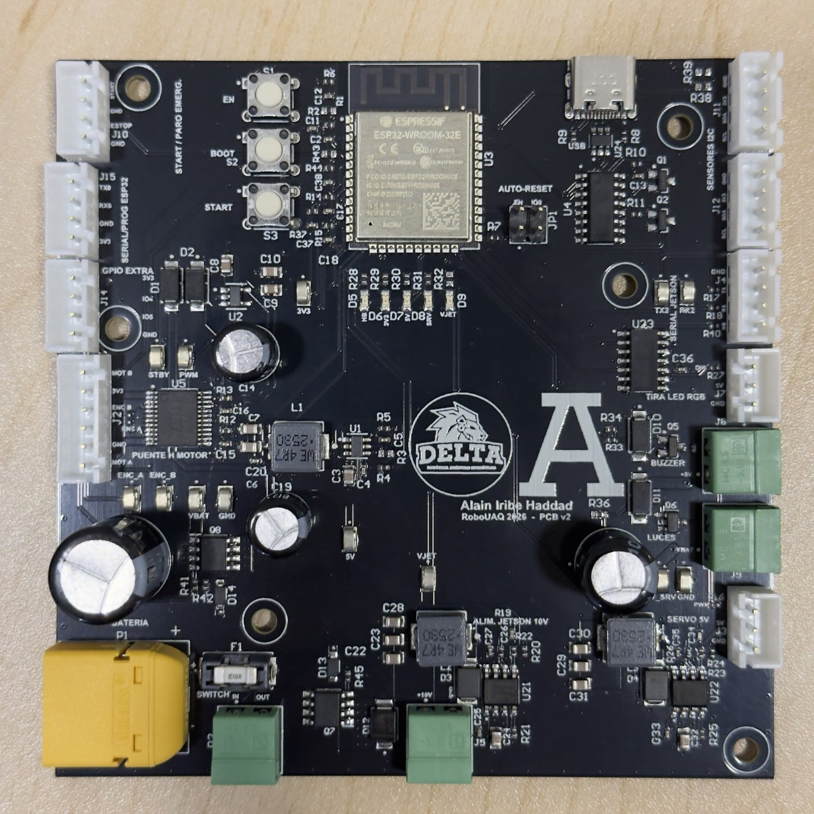

# PCB Autonomo_V2

Documentación de la placa de control del carro autónomo a escala 1:10 del equipo DELTA (Universidad Anáhuac Querétaro) para la categoría de conducción urbana de RoboUAQ.

**Sitio:** https://patoiribe10-sys.github.io/autonomo-v2-pcb/

**Manual interactivo:** https://patoiribe10-sys.github.io/autonomo-v2-pcb/manual/ (placa clickeable, qué conectar en cada conector, compras y problemas)



La placa recibe una batería LiPo 3S y saca de ahí cuatro voltajes: 10 V para una Jetson Orin Nano, 5 V para la lógica, 5 V aparte para el servo y 3.3 V. Lleva un ESP32-WROOM-32E que controla el motor y la dirección. Son 4 capas en 100 × 100 mm, diseñada en Altium Designer y fabricada con ensamblaje en PCBWay.

## Contenido

| Tema | Página |
|---|---|
| Diagrama Top-Level | [docs/sistema/top-level.md](docs/sistema/top-level.md) |
| Diagrama de funcionamiento del sistema | [docs/sistema/funcionamiento.md](docs/sistema/funcionamiento.md) |
| Esquemático | [docs/hardware/esquematico.md](docs/hardware/esquematico.md) |
| Diseño de la PCB | [docs/hardware/pcb.md](docs/hardware/pcb.md) |
| Ubicación de componentes | [docs/hardware/README.md](docs/hardware/README.md) |
| Componentes principales | [docs/hardware/componentes.md](docs/hardware/componentes.md) |
| Lista de materiales (BOM) | [docs/hardware/bom.md](docs/hardware/bom.md) |
| Diagrama de alimentación | [docs/hardware/alimentacion.md](docs/hardware/alimentacion.md) |
| Pines de salida (Pinout) | [docs/hardware/pinout.md](docs/hardware/pinout.md) |
| Conectividad (USB y Bluetooth) | [docs/hardware/conectividad.md](docs/hardware/conectividad.md) |
| Fotografía del resultado final | [docs/resultado.md](docs/resultado.md) |
| Guía de usuario | [docs/guia/README.md](docs/guia/README.md) |
| Manual interactivo | [manual/](https://patoiribe10-sys.github.io/autonomo-v2-pcb/manual/) · [docs/manual.md](docs/manual.md) |
| Recomendación de plataforma para documentación | [docs/plataforma.md](docs/plataforma.md) |

## Carpetas

| Carpeta | Contenido |
|---|---|
| `docs/` | Documentación en Markdown |
| `hardware/` | Esquemático en PDF, Gerbers, BOM, CPL, plano mecánico y proyecto de Altium |
| `firmware/prueba-pcb/` | Firmware de prueba (PlatformIO) |
| `assets/` | Imágenes y archivos del sitio |
| `reporte/` | Reporte técnico en PDF |

## Cómo actualizar la documentación

1. Edita el archivo `.md` que corresponda en `docs/`. Las rutas a imágenes y archivos son relativas a ese archivo.
2. Si agregas una página nueva, dala de alta en la lista `NAV` de `assets/js/app.js`.
3. Los tres diagramas (`assets/img/diagrama-*.svg`) son SVG editables; el PNG de cada uno es el que se muestra.
4. Sube el cambio a `main`. GitHub Pages publica solo.

## Ver el sitio en tu computadora

El sitio es estático. Desde la carpeta del repositorio:

```
python -m http.server 8000
```

y abre `http://localhost:8000`.

## Estado

Placa recibida el 23 de noviembre de 2026 y montada en el carro. Ya se probó por USB y con batería: los cuatro reguladores dan su voltaje, y el motor, el servo, el encoder y el paro funcionan. Falta la prueba con la Jetson. Fotos y mediciones en [docs/resultado.md](docs/resultado.md).

## Licencia

Puedes usar, copiar y modificar este proyecto siempre que des crédito a Alain Iribe Haddad.

- Diseño de la placa, documentación e imágenes: [Creative Commons Atribución 4.0 (CC BY 4.0)](LICENSE).
- Firmware de prueba (`firmware/`): [licencia MIT](firmware/LICENSE).

## Autor

Alain Iribe Haddad · Ingeniería Mecatrónica, Universidad Anáhuac Querétaro · Equipo DELTA
