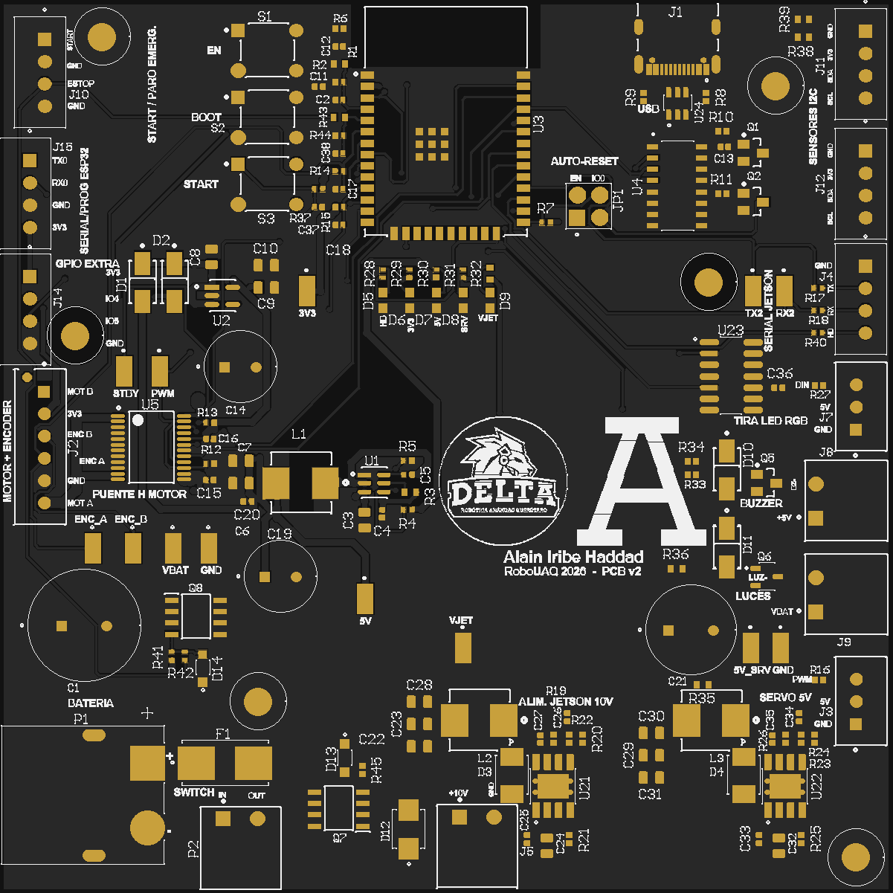

# PCB Autonomo_V2

- [Esquemático (PDF)](../hardware/Autonomo_V2_esquematico.pdf)
- [BOM (Excel)](../hardware/Autonomo_V2_BOM_CPL.xlsx)
- [Gerbers y drill](../hardware/Autonomo_V2_gerber_drill_4capas.zip)
- [Proyecto de Altium](../hardware/Proyecto_Alain_Altium.zip)

La Autonomo_V2 es la placa de control del carro autónomo a escala 1:10 con el que el equipo DELTA compite en la categoría de conducción urbana de RoboUAQ. Recibe la batería, genera todos los voltajes del carro y lleva el ESP32 que mueve el motor y la dirección siguiendo las órdenes de una Jetson Orin Nano.

Es la segunda versión. La primera se hizo en KiCad con módulos comerciales (DevKit del ESP32, convertidores XL4016 y Mini560) y se soldó a mano. Esta se diseñó en Altium Designer con todo integrado en la misma placa y se mandó a fabricar ya ensamblada.

## Datos generales

| Característica | Valor |
|---|---|
| Tamaño | 100 × 100 mm, 1.6 mm de espesor |
| Capas | 4 (señal y potencia, GND, potencia, señal), cobre de 1 oz |
| Material y acabado | FR-4 TG150, HASL sin plomo, máscara negra, serigrafía blanca |
| Microcontrolador | ESP32-WROOM-32E de 4 MB, con Wi-Fi y Bluetooth |
| Entrada | Batería LiPo 3S (11.1 V nominal) por XT60, fusible de 10 A |
| Voltajes que genera | 10 V para la Jetson, 5 V de lógica, 5 V aparte para el servo y 3.3 V |
| Motor | Puente H TB6612FNG con los dos canales en paralelo |
| Programación | USB-C con CH340C y auto-reset |
| Piezas | 148 en 52 líneas de BOM, todas en la cara superior |
| Fabricación | PCBWay, con ensamblaje incluido |

## Qué hay en este sitio

| Sección | Contenido |
|---|---|
| [Diagrama Top-Level](sistema/top-level.md) | La placa dentro del carro: qué se le conecta y por dónde |
| [Funcionamiento del sistema](sistema/funcionamiento.md) | Bloques internos y cómo pasa una orden de la Jetson a las llantas |
| [Recorrido de la placa](hardware/README.md) | Ubicación de componentes, conectores, botones, LEDs y test points |
| [Componentes principales](hardware/componentes.md) | Los integrados y por qué se eligió cada uno |
| [Esquemático](hardware/esquematico.md) | Hoja completa y explicación por bloques |
| [Diseño de la PCB](hardware/pcb.md) | Capas, reglas, ruteo y vista 3D |
| [Alimentación](hardware/alimentacion.md) | Árbol de voltajes, protecciones y consumos |
| [Pinout](hardware/pinout.md) | Pines del ESP32 y de cada conector |
| [Conectividad](hardware/conectividad.md) | USB, serial con la Jetson, Bluetooth y Wi-Fi |
| [BOM completo](hardware/bom.md) | Las 52 líneas con número de parte |
| [Archivos de diseño](hardware/archivos.md) | Todo lo descargable |
| [Guía de usuario](guia/README.md) | Cómo conectarla, programarla y probarla |
| [Resultado final](resultado.md) | Estado de la fabricación y fotos |
| [Plataforma de documentación](plataforma.md) | Por qué la documentación vive en un repositorio |

## Qué cambió respecto a la primera versión

La v1 funcionó, pero dejó una lista de problemas que esta placa corrige:

| Problema en la v1 | Solución en la v2 |
|---|---|
| El pin STBY del puente H se quedaba en 2.2 V | Resistencia pull-up de 10 kΩ (R13) |
| El TX hacia la Jetson medía 0.54 V en reposo y se tuvo que usar USB | Resistencias en serie de 330 Ω y test points en TX y RX |
| La Jetson reiniciaba al ESP32 al abrir el puerto | Jumper JP1 para desconectar el auto-reset |
| El servo tumbaba los 5 V de la lógica | Regulador propio para el servo con 1000 µF a la salida |
| No había paro físico ni protección de batería | Paro de emergencia por hardware, protección contra inversión, TVS y fusible |
| Convertidores y DevKit eran módulos sueltos | Todo va soldado en la placa |

## Estado

El diseño se cerró el 29 de octubre de 2026 con el DRC en cero. El pedido a PCBWay (5 placas, 2 ensambladas) se pagó el 3 de noviembre; las placas desnudas salieron de fabricación el 7 y el ensamblaje está en curso. Llegan a mediados de diciembre. Las pruebas eléctricas se van a documentar en [Resultado final](resultado.md).

## Créditos

Diseño: Alain Iribe Haddad, Ingeniería Mecatrónica, Universidad Anáhuac Querétaro. Equipo de robótica DELTA.
