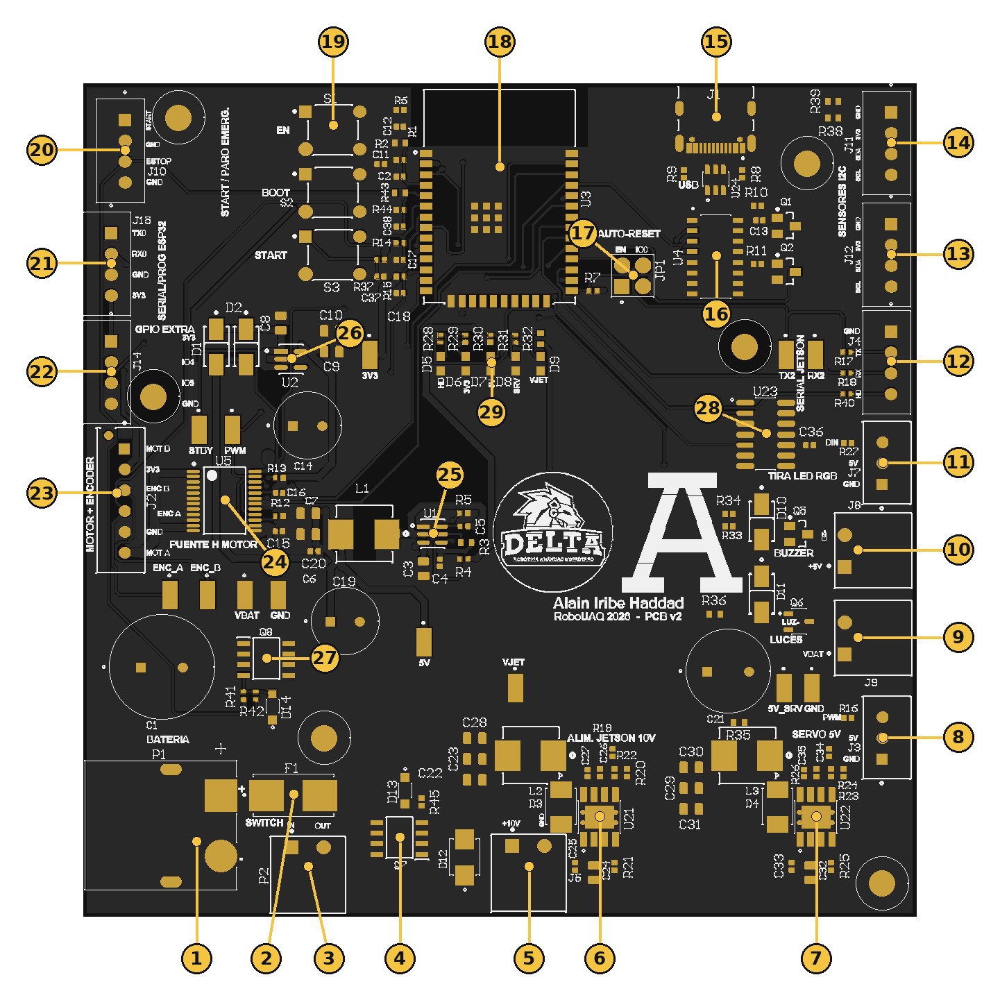
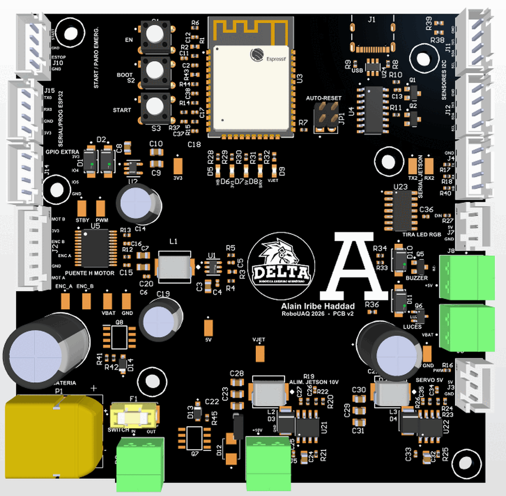

# Hardware

- [Esquemático](../../hardware/Autonomo_V2_esquematico.pdf)
- [BOM](../../hardware/Autonomo_V2_BOM_CPL.xlsx)
- [Gerber](../../hardware/Autonomo_V2_gerber_drill_4capas.zip)
- [Plano mecánico](../../hardware/Plano_PCB_Autonomo_V2_soporte.pdf)

| Página | Contenido |
|---|---|
| **Recorrido de la placa** (esta página) | Ubicación de componentes, conectores, botones, LEDs y test points |
| [Componentes principales](componentes.md) | Integrados y criterio de selección |
| [Esquemático](esquematico.md) | Hoja completa y bloques |
| [Diseño de la PCB](pcb.md) | Capas, reglas y ruteo |
| [Alimentación](alimentacion.md) | Árbol de voltajes y consumo por riel |
| [Pinout](pinout.md) | ESP32 y conectores, pin por pin |
| [Conectividad](conectividad.md) | USB, UART, Bluetooth y Wi-Fi |
| [BOM completo](bom.md) | Las 52 líneas |
| [Archivos de diseño](archivos.md) | Descargas |

## Ubicación de componentes

La placa se acomodó siguiendo el camino de la energía. La batería entra por la esquina inferior izquierda, los reguladores quedan a lo largo del borde de abajo y el ESP32 está arriba, con la antena pegada al borde y sin cobre debajo. Todos los conectores están en la orilla, con la boca hacia afuera.

**Tabla 1.** Componentes señalados en la Figura 1.

| # | Ref. | Serigrafía | Función |
|---|---|---|---|
| 1 | P1 | BATERIA | Entrada de batería, XT60 |
| 2 | F1 | | Fusible de 10 A |
| 3 | P2 | SWITCH | Lazo del interruptor principal |
| 4 | Q7 | | MOSFET de protección contra inversión |
| 5 | J5 | ALIM. JETSON 10V | Salida de 10 V para la Jetson |
| 6 | U21 | | Regulador conmutado de 10 V |
| 7 | U22 | | Regulador conmutado de 5 V del servo |
| 8 | J3 | SERVO 5V | Servo de dirección |
| 9 | J9 | LUCES | Luces, a voltaje de batería |
| 10 | J8 | BUZZER | Buzzer de 5 V |
| 11 | J7 | TIRA LED RGB | Tira WS2812 |
| 12 | J4 | SERIAL JETSON | UART hacia la Jetson |
| 13 | J12 | SENSORES I2C | Bus I2C |
| 14 | J11 | SENSORES I2C | Bus I2C |
| 15 | J1 | USB | USB-C de programación |
| 16 | U4 | | CH340C, convertidor USB a serial |
| 17 | JP1 | AUTO-RESET | Jumper del auto-reset |
| 18 | U3 | | Módulo ESP32-WROOM-32E |
| 19 | S1, S2, S3 | EN, BOOT, START | Botones |
| 20 | J10 | START / PARO EMERG. | Botón START externo y lazo del paro |
| 21 | J15 | SERIAL/PROG ESP32 | UART0 del ESP32, para un programador externo |
| 22 | J14 | GPIO EXTRA | Dos pines libres del ESP32 |
| 23 | J2 | MOTOR + ENCODER | Motor y encoder en un solo conector |
| 24 | U5 | PUENTE H MOTOR | TB6612FNG |
| 25 | U1 | | Regulador conmutado de 5 V de lógica |
| 26 | U2 | | Regulador lineal de 3.3 V |
| 27 | Q8 | | MOSFET que corta el motor con el paro |
| 28 | U23 | | Buffer de 3.3 V a 5 V |
| 29 | D5–D9 | HB, 3V3, 5V, SRV, VJET | LEDs indicadores |

## Conectores

Los conectores de cable son JST XH de paso 2.5 mm, porque los cables se hacen en el equipo con pinzas de crimpado. Lo que lleva más corriente usa borneras enchufables Phoenix de 3.81 mm, y la batería un XT60.

**Tabla 2.** Conectores de la placa.

| Ref. | Tipo | Pines |
|---|---|---|
| P1 | XT60PW-M | + y − de la batería |
| P2 | Phoenix 2 pines | IN y OUT del interruptor |
| J1 | USB-C | Programación y monitor serial |
| J2 | XH 6 pines | Motor (2), encoder A/B, 3.3 V y GND |
| J3 | XH 3 pines | GND, 5 V, PWM |
| J4 | XH 4 pines | GND, TX, RX, HB |
| J5 | Phoenix 2 pines | +10 V, GND |
| J7 | XH 3 pines | GND, 5 V, DIN |
| J8 | Phoenix 2 pines | +5 V y retorno conmutado |
| J9 | Phoenix 2 pines | VBAT y retorno conmutado |
| J10 | XH 4 pines | START, GND, ESTOP, GND |
| J11, J12 | XH 4 pines | GND, 3.3 V, SDA, SCL |
| J14 | XH 4 pines | 3.3 V, IO4, IO5, GND |
| J15 | XH 4 pines | TX0, RX0, GND, 3.3 V |

El orden exacto de cada pin está en [Pinout](pinout.md).

## Botones y jumper

| Ref. | Nombre | Qué hace |
|---|---|---|
| S1 | EN | Reinicia el ESP32 |
| S2 | BOOT | Presionado durante el reinicio, pone al ESP32 en modo de carga |
| S3 | START | Botón de arranque del carro (IO27, activo en bajo). Está en paralelo con el pin 1 de J10 |
| JP1 | AUTO-RESET | Con los dos puentes puestos, la computadora puede reiniciar al ESP32 para programarlo. Sin ellos, abrir el puerto serial ya no lo reinicia |

## LEDs

| Ref. | Etiqueta | Enciende cuando |
|---|---|---|
| D5 | HB | El firmware lo parpadea (IO2) |
| D6 | 3V3 | Hay 3.3 V |
| D7 | 5V | Hay 5 V de lógica |
| D8 | SRV | Hay 5 V del servo |
| D9 | VJET | Hay 10 V para la Jetson |

## Test points

Cada señal que dio problemas en la v1 tiene ahora un punto de prueba al lado.

| TP | Señal | TP | Señal |
|---|---|---|---|
| TP1 | MOT_STBY | TP8 | +5V |
| TP2 | MOT_PWM | TP9 | +3V3 |
| TP3 | ENC_A | TP10 | +5V_SERVO |
| TP4 | ENC_B | TP11 | +VJET |
| TP5 | UART2_TX | TP12 | GND |
| TP6 | UART2_RX | TP13 | GND |
| TP7 | VBAT | | |

## Mecánica

- 100 × 100 mm, esquinas rectas, 1.6 mm de espesor.
- Seis barrenos M3 sin metalizar de 3.2 mm. Con el origen en la esquina inferior izquierda quedan en (8.5, 62.5), (11.5, 96), (29, 21.5), (79.5, 68.5), (87, 90.5) y (96, 4) mm.
- La pieza más alta es el capacitor C1, de unos 20 mm.
- Hay conectores en los cuatro bordes; el soporte tiene que dejarlos libres.

El plano acotado y el DXF de los barrenos están en [Archivos de diseño](archivos.md).
