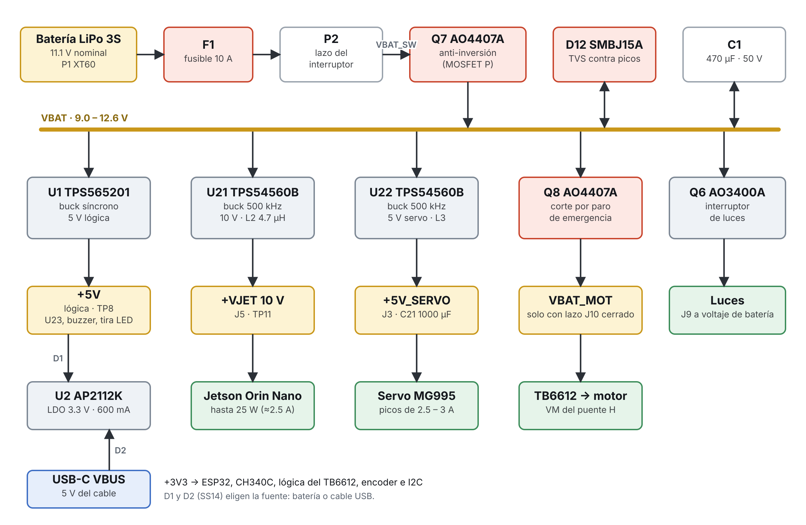

# Alimentación

Todo sale de una batería LiPo de tres celdas. La placa la protege, la reparte y genera cuatro voltajes regulados. Los módulos XL4016 y Mini560 que el carro llevaba sueltos ya no hacen falta.

## Rieles

**Tabla 1.** Voltajes de la placa.

| Riel | Voltaje | Lo genera | Alimenta | Dónde medirlo |
|---|---|---|---|---|
| VBAT | 9.0 a 12.6 V | Batería, después de F1, P2 y Q7 | Los tres reguladores, luces | TP7 |
| VBAT_MOT | Igual a VBAT | Q8, solo con el paro cerrado | Puente H (motor) | Pin VM de U5 |
| +VJET | 10 V | U21 | Jetson Orin Nano por J5 | TP11 |
| +5V_SERVO | 5.2 V | U22 | Servo por J3 | TP10 |
| +5V | 4.9 V | U1 | Buffer U23, buzzer, tira LED, entrada del LDO | TP8 |
| +3V3 | 3.3 V | U2 | ESP32, CH340C, lógica del puente H, encoder, I2C | TP9 |

Cada riel regulado tiene su LED (D6 a D9), así que de un vistazo se sabe cuál falta.

## Protecciones de entrada

| Pieza | Protege contra | Cómo |
|---|---|---|
| F1, fusible de 10 A | Cortocircuito | Abre el positivo de la batería. Va en portafusible, se cambia sin soldar |
| P2, interruptor | | Lazo en serie. Sin interruptor o puente, la placa no enciende |
| Q7, MOSFET P | Batería al revés | Solo conduce con la polaridad correcta |
| D12, TVS de 15 V | Picos de voltaje | Recorta los transitorios del motor y del cable de batería |
| C1, 470 µF | Caídas momentáneas | Reserva de energía junto a la entrada |

## Consumo estimado

| Carga | Corriente |
|---|---|
| Jetson Orin Nano (hasta 25 W) | Unos 2.5 A a 10 V |
| Servo MG995 | Picos de 2.5 a 3 A |
| Lógica de 5 V | Menos de 0.5 A |
| 3.3 V | Unos 0.4 A |
| **Pico total desde la batería** | **7 a 9 A** |

De ahí sale el fusible de 10 A: deja pasar el pico normal y abre si algo entra en corto. Son estimaciones de diseño. Las mediciones reales se agregarán cuando llegue la placa.

## Reguladores

### +VJET, 10 V para la Jetson (U21)

Son los mismos 10 V con los que la Jetson ya trabajaba en el carro, antes generados por un módulo XL4016 externo; quedan por debajo de la batería de 11.1 V para que el regulador tenga margen. El TPS54560B trabaja a 500 kHz con un inductor de 4.7 µH; el rizado de corriente calculado es de unos 0.9 A.

Tiene una limitación que se conoce y se aceptó: un regulador reductor no puede entregar más de lo que recibe. Con la batería muy descargada VBAT se acerca a 10 V y la salida baja con ella. La Jetson no se apaga, pero puede reiniciarse. Se maneja cuidando la carga y el balance de las celdas, y con el aviso de batería baja por buzzer.

### +5V_SERVO (U22)

Mismo integrado y mismo esquema, con salida de 5.2 V y un capacitor de 1000 µF (C21) junto al conector del servo. Al estar separado de la lógica, los picos del servo ya no llegan al ESP32.

### +5V de lógica (U1)

TPS565201, un regulador síncrono más pequeño. Alimenta lo que necesita 5 V limpios: el buffer de señales, el buzzer, la tira LED y la entrada del regulador de 3.3 V.

### +3V3 (U2)

AP2112K, lineal, de 600 mA. Recibe 5 V por D1 cuando hay batería o por D2 cuando solo está el USB.

## Con qué se puede encender

| Fuente | Qué funciona |
|---|---|
| Solo cable USB | ESP32 y CH340C. Sirve para programar y ver el monitor serial. Motor, servo, Jetson, buzzer y tira LED quedan apagados |
| Batería con el interruptor cerrado | Todo |
| Batería, con el lazo del paro abierto | Todo menos el motor |

## Batería

El divisor R1/R2 (100 kΩ y 22 kΩ) lleva el voltaje de la batería a IO36 del ESP32. La lectura se multiplica por 5.545. Una LiPo 3S va de 12.6 V cargada a unos 9 V descargada, que en el pin son 2.27 V y 1.62 V: siempre dentro del rango del convertidor.
