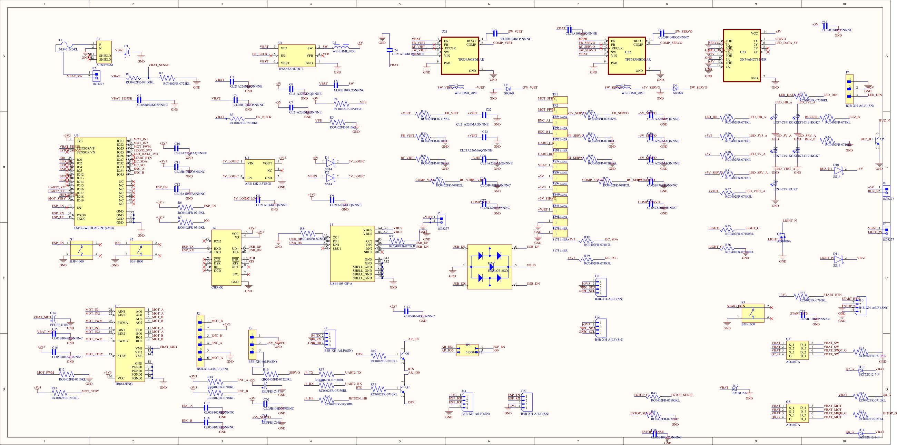

# Esquemático

- [Esquemático en PDF](../../hardware/Autonomo_V2_esquematico.pdf)
- [Proyecto de Altium](../../hardware/Proyecto_Alain_Altium.zip)

El esquemático está en una sola hoja, `Autonomo_V2.SchDoc`, dentro del proyecto `Proyecto_Alain.PrjPcb` de Altium Designer. Las conexiones entre bloques se hacen con etiquetas de red en lugar de cables largos, así cada bloque se puede leer por separado.

## Bloques

**Tabla 1.** Bloques del esquemático y redes que los unen.

| Bloque | Piezas principales | Redes de entrada | Redes de salida |
|---|---|---|---|
| Entrada de batería | P1, F1, P2, Q7, D12, D13, C1 | Batería | VBAT |
| 5 V de lógica | U1, L1, R4, R5 | VBAT | +5V |
| 3.3 V | D1, D2, U2 | +5V o VBUS | +3V3 |
| 10 V de la Jetson | U21, L2, D3, R19–R22 | VBAT | +VJET |
| 5 V del servo | U22, L3, D4, R23–R26 | VBAT | +5V_SERVO |
| Microcontrolador | U3, S1, S2, R6, R7, C12 | +3V3 | Todas las señales |
| USB | J1, U24, U4, Q1, Q2, JP1 | VBUS, USB_DP, USB_DN | ESP_TX, ESP_RX, ESP_EN, IO0 |
| Motor | U5, J2, R12–R15 | MOT_IN1, MOT_IN2, MOT_PWM, MOT_STBY, VBAT_MOT | MOT_A, MOT_B, ENC_A, ENC_B |
| Paro de emergencia | Q8, D14, R41–R44, J10 | VBAT | VBAT_MOT, ESTOP_SENSE |
| Buffer de 5 V | U23, R16, R27 | SERVO_3V3, LED_DATA_3V3 | SERVO, LED_DIN |
| Salidas | Q5, Q6, D10, D11, J8, J9 | BUZZER, LIGHTS | Buzzer y luces |
| Indicadores | D5–D9, R28–R32 | LED_HB y los cuatro rieles | |
| Sensores y expansión | J11, J12, J14, J15, R38, R39 | I2C_SDA, I2C_SCL, EXP_IO4, EXP_IO5 | |
| Test points | TP1–TP13 | | |

## Detalles que vale la pena explicar

### Entrada de batería

El positivo de la batería pasa primero por el fusible F1 y sale de la placa hacia el interruptor por P2. Regresa como VBAT_SW y cruza Q7. Si no hay interruptor ni puente en P2, nada enciende.

Q7 es un MOSFET canal P con la compuerta a GND a través de 10 kΩ. Con la batería bien conectada conduce; con la batería al revés, se queda abierto. D12 recorta los picos por arriba de 15 V.

### Dos fuentes para los 3.3 V

El regulador U2 se alimenta de la red `5V_LOGIC`, a la que llegan dos diodos Schottky: D1 desde los 5 V de la placa y D2 desde el VBUS del USB. Gracias a eso el ESP32 se puede programar con solo el cable USB, sin batería. Los diodos impiden que una fuente alimente a la otra.

### Voltaje de salida de los reguladores

Los tres conmutados fijan su salida con un divisor resistivo:

| Regulador | Referencia | Divisor | Salida calculada |
|---|---|---|---|
| U1 (TPS565201) | 0.76 V | R4 54.9 kΩ / R5 10 kΩ | 4.93 V |
| U21 (TPS54560B) | 0.8 V | R19 115 kΩ / R20 10 kΩ | 10.0 V |
| U22 (TPS54560B) | 0.8 V | R23 54.9 kΩ / R24 10 kΩ | 5.19 V |

U21 y U22 trabajan a 500 kHz, fijados con resistencias de 200 kΩ en el pin RT. La compensación (8.2 kΩ, 4.7 nF y 82 pF) se calculó con las ecuaciones de la hoja de datos para un cruce de unos 30 kHz. Es un cálculo y no una medición: si al probar la placa el riel oscila, la resistencia a ajustar es R22 (o R26 en el del servo).

### Auto-reset

Q1 y Q2 son el circuito clásico de las tarjetas ESP32: con DTR y RTS del CH340C bajan EN e IO0 en el orden que pide el modo de carga. Entre ese circuito y el ESP32 está JP1. Se agregó porque en la v1 la Jetson reiniciaba al micro cada vez que abría el puerto.

### Paro de emergencia

La compuerta de Q8 tiene pull-up a VBAT (R41, 10 kΩ) y sale por R42 (1 kΩ) hacia el pin 3 de J10. Con el lazo cerrado a GND la compuerta queda cerca de 0 V y el MOSFET conduce. Abierto el lazo, sube a VBAT y se corta. R43 y R44 forman el divisor que le deja al ESP32 leer ese estado en IO39.

### Encoder

Los canales del encoder llegan a IO34 e IO35, que en el ESP32 son solo de entrada y no tienen pull-up interno. Por eso están R14 y R15 (10 kΩ a 3.3 V), con C17 y C18 de 1 nF para filtrar ruido.

## Verificación

La hoja compila sin errores en Altium (Validate PCB Project). La transferencia al PCB se hizo por ECO y la placa terminó con el DRC en cero violaciones.
