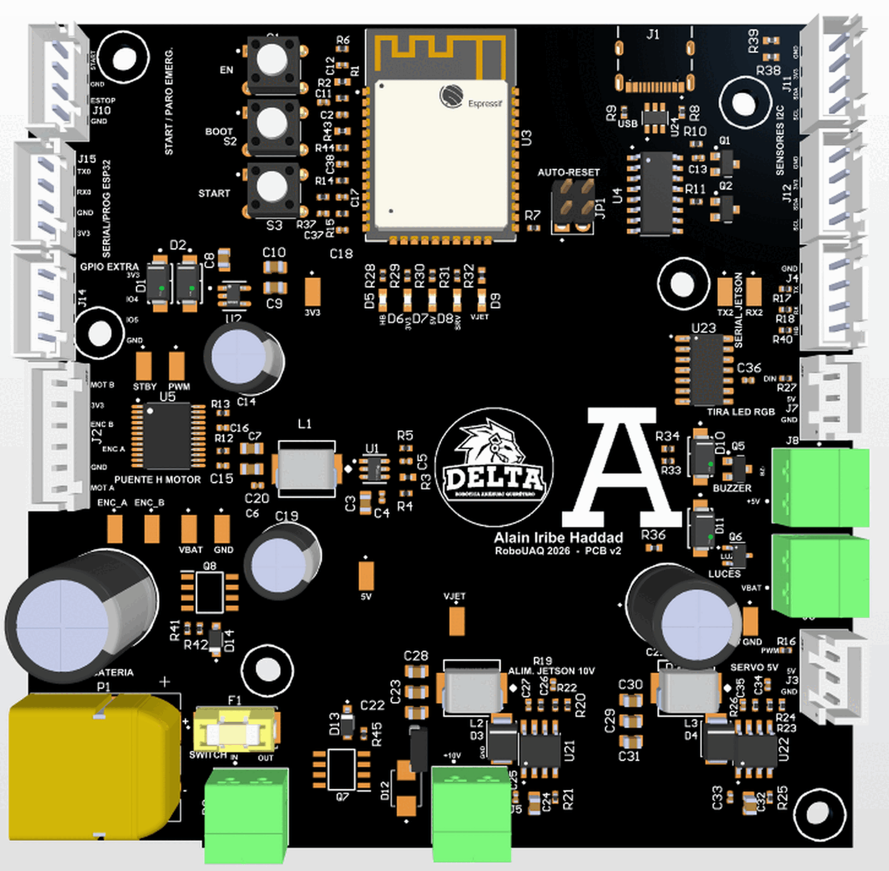

# Diseño de la PCB

- [Gerbers y drill](../../hardware/Autonomo_V2_gerber_drill_4capas.zip)
- [Proyecto de Altium](../../hardware/Proyecto_Alain_Altium.zip)
- [Plano mecánico](../../hardware/Plano_PCB_Autonomo_V2_soporte.pdf)

## Especificaciones de fabricación

| Parámetro | Valor |
|---|---|
| Tamaño | 100 × 100 mm |
| Capas | 4 |
| Espesor | 1.6 mm |
| Material | FR-4 TG150 |
| Cobre | 1 oz en las cuatro capas |
| Acabado | HASL sin plomo |
| Máscara y serigrafía | Negra con texto blanco |
| Vías | Tapadas con máscara (tented) |
| Pista y separación mínimas | 6 / 6 mil |
| Barreno mínimo | 0.3 mm |
| Montaje | 148 piezas, solo en la cara superior |

El límite de 100 × 100 mm no es casual: es el tamaño hasta el que el fabricante cobra la tarifa de prototipo.

## Apilado de capas

| Capa | Archivo Gerber | Uso |
|---|---|---|
| L1 | GTL | Componentes, señales y potencia |
| L2 | G1 | Plano de GND completo |
| L3 | G2 | Plano de potencia, dividido por zonas |
| L4 | GBL | Señales |

 arriba a la derecha, L3 (potencia) abajo a la izquierda y L4 abajo a la derecha.")

Se eligieron cuatro capas por dos motivos. El primero es el plano de GND sin cortes en L2, que le da a cada señal su retorno justo debajo y mantiene cortos los lazos de los reguladores conmutados. El segundo es de espacio: con tres reguladores, el puente H y quince conectores en 10 × 10 cm, en dos capas la potencia y las señales se estorbaban.

En la Figura 1 se ve el rectángulo sin cobre de la parte de arriba, igual en las cuatro capas. Es la zona libre debajo de la antena del ESP32.

## Colocación

- **La energía avanza en orden.** Batería, fusible y protección en la esquina inferior izquierda; los reguladores de 10 V y del servo sobre el borde de abajo, cada uno junto al conector que alimenta.
- **Lazos de conmutación compactos.** En cada regulador, el capacitor de entrada, el integrado, el diodo y el inductor están pegados.
- **Lo sensible, lejos.** Encoder, UART, I2C y USB quedaron a 15 mm o más de cualquier nodo de conmutación.
- **Conectores en la orilla,** con el nombre de su función en la serigrafía ("MOTOR + ENCODER", "SERIAL JETSON") para que cualquiera del equipo pueda conectar el carro sin abrir el esquemático.
- **Pasivos alineados** con el pin que atienden, en cuadrícula.

## Reglas de diseño

Las redes se agruparon en clases para darle a cada una el ancho que necesita.

**Tabla 1.** Anchos de pista por clase de red.

| Clase | Redes | Mínimo | Preferido | Máximo |
|---|---|---|---|---|
| Señal | Todo lo demás | 0.15 mm | 0.25 mm | 1.0 mm |
| USB | USB_DP, USB_DN | 0.20 mm | 0.28 mm | 0.35 mm |
| GND | GND | 0.30 mm | 0.60 mm | 8.0 mm |
| POWER | +5V, +3V3, VBUS, 5V_LOGIC, SW | 0.50 mm | 0.80 mm | 6.0 mm |
| POWER_HI | VBAT, VBAT_SW, VBAT_MOT, MOT_A, MOT_B, +VJET, +5V_SERVO y nodos de conmutación | 0.50 mm | 1.50 mm | 8.0 mm |

**Tabla 2.** Otras reglas.

| Regla | Valor |
|---|---|
| Separación general | 0.15 mm (5.9 mil) |
| Separación de POWER_HI contra todo | 0.20 mm (7.9 mil) |
| Separación entre barrenos | 10 mil |
| Puente mínimo de máscara | 3 mil |
| Serigrafía a pad y entre textos | 4 mil |
| Conexión a planos | Alivio térmico de 4 brazos, 10 mil |

En las zonas alrededor de los integrados de paso fino hay una regla local que permite pistas de 0.2 mm, porque una pista de potencia de 1.5 mm no entra en un pad de 0.4 mm. Fuera de esas zonas aplica el ancho completo.

## Ruteo

La potencia y los lazos de los reguladores se trazaron primero, con polígonos donde hacía falta más cobre. Para el resto se intentó el autorouter de Altium y no terminó, así que las pistas que faltaban se cerraron con un ruteador propio: un script lee el cobre existente, busca cada camino con A* revisando la separación en cada tramo y dibuja pistas y vías.

Además de L2, hay polígonos de GND en L1 y L4 unidos con 172 vías de cosido.

## Verificación

El DRC final (29 de octubre de 2026) reporta **0 violaciones y 0 advertencias** con todas las reglas activas, incluidas redes sin rutear, cortos y antenas de red.

## Lo que preguntó el fabricante

Antes de producir, PCBWay pidió confirmar dos cosas del diseño:

- **Máscara entre los pines del USB-C.** La separación entre esos pads es de 0.2 mm y la tinta negra necesita 0.22 mm para dejar un puente de máscara. Se mantuvo el color negro y esa fila va sin puente; al recibir la placa hay que revisarla con lupa.
- **Ranuras del XT60.** Las dos ranuras metalizadas de las patas eran rectangulares de 0.6 mm y se fabrican ovaladas del mismo tamaño.

## Pendientes para una v3

- Corregir en el esquemático el voltaje de C24 y C32 (dice 16 V; se pidieron de 25 V).
- Dibujar ovaladas las ranuras del XT60 desde la huella.
- Alinear el modelo 3D del inductor, que está desfasado.
- Rehacer el Output Job para generar todas las salidas en un solo paso.
