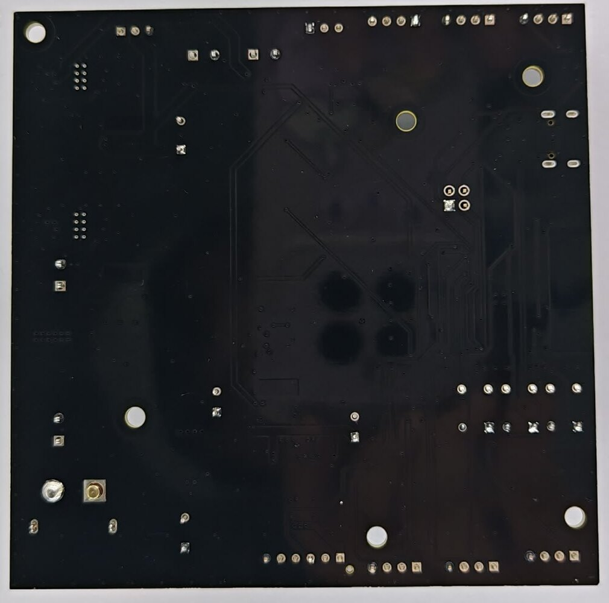

# Resultado final

## Estado al 16 de noviembre de 2026

La placa ya existe. Está en la línea de ensamblaje de PCBWay con los componentes de montaje superficial soldados y los through-hole colocados. El 16 de noviembre el ensamblador mandó fotos para confirmar la orientación de las piezas con polaridad antes de terminar de soldar, recortar terminales y limpiar.

| Fecha | Avance |
|---|---|
| 29 de octubre | Diseño cerrado, DRC en cero, archivos de fabricación generados |
| 30 de octubre a 3 de noviembre | Cotización, dudas del fabricante resueltas y pago del pedido |
| 7 de noviembre | Placas fabricadas y con prueba eléctrica |
| 16 de noviembre | Componentes montados; fotos de revisión y orientación confirmada |
| Mediados de diciembre | Llegada estimada |

El pedido es de cinco placas, dos de ellas ensambladas con todos los componentes, incluidos los through-hole.

## Del modelo a la placa

 junto al modelo 3D de Altium (derecha), en la misma orientación.")

La placa salió igual al modelo: mismas posiciones, misma serigrafía y los conectores viendo hacia afuera. En el centro quedaron el logotipo del equipo DELTA, la "A" de la Anáhuac y el nombre del diseñador, sin piezas encima.

## Acercamientos

 con su inductor, su diodo y la bornera J5.")

 junto al conector J3. Derecha: regulador de 5 V de la lógica (U1).")

, con los diodos D1 y D2 y el regulador de 3.3 V (U2) arriba. Derecha: buffer de 5 V (U23) y las salidas de buzzer y luces.")

. Derecha: módulo ESP32 y los cinco LEDs indicadores. Las etiquetas con el signo + las puso el ensamblador para preguntar por la polaridad.")

## Revisión de orientación

Las fotos se compararon contra el archivo de la PCB: para cada pieza con polaridad se tomó de qué lado queda cada red en el diseño y se buscó la marca correspondiente en la fotografía.

**Tabla 1.** Resultado de la revisión visual.

| Piezas | Qué se revisó | Resultado |
|---|---|---|
| C1, C14, C19, C21 | Franja del negativo del lado de GND | Correcto en los cuatro |
| D1, D2, D10, D11 (SS14) | Banda del cátodo | Correcto |
| D3, D4 (SK56B) | Banda del cátodo hacia el inductor | Correcto |
| D12 (TVS) | Banda del cátodo hacia el borde de la placa | Correcto |
| D14 (zener) | Banda del cátodo hacia VBAT | Correcto |
| U1, U4, U5, U21, U22, U23, U24 | Marca del pin 1 | Correcto |
| Q7, Q8 | Marca del pin 1 | Correcto |
| Conectores JST y borneras | Sentido contra el modelo 3D | Correcto |
| D5 a D9 (LEDs) | Los cinco van en el mismo sentido | La marca del cátodo no se distingue en la foto |
| D13 (zener) | | No hay acercamiento y la marca no se distingue |

Al ensamblador se le confirmó que continuara y se le dejó por escrito la regla para lo que no se alcanza a ver: en los LEDs el ánodo va del lado de las resistencias R28 a R32, y en D13 la banda del cátodo va hacia el punto blanco de la serigrafía.

Es una revisión de fotos. Sirve para descartar piezas al revés, no para saber si la placa funciona.

## Lo que ya se puede afirmar

- El diseño cumple todas las reglas de fabricación (DRC sin violaciones).
- El fabricante aceptó los archivos y el BOM completo, y las placas desnudas pasaron su prueba eléctrica.
- La placa ensamblada coincide con el modelo y las piezas con polaridad que se ven en las fotos están bien orientadas.
- El firmware de prueba compila y el plan de pruebas está escrito.

## Lo que falta comprobar

Nada de lo siguiente está medido todavía:

- Voltajes reales de los cuatro rieles, con y sin carga.
- Estabilidad y rizado de los reguladores de 10 V y del servo.
- Comunicación por UART con la Jetson, que fue la falla principal de la v1.
- Comportamiento térmico con el carro en movimiento.
- Alcance del Bluetooth con la placa montada.
- Los pines del USB-C, que van sin puente de máscara y hay que ver con lupa.

Cuando la placa llegue se seguirá el [plan de pruebas](guia/pruebas.md) y esta página se actualiza con la tabla de mediciones y las correcciones que hagan falta.

## Carro donde se va a montar

La placa sustituye a la v1 en el carro a escala 1:10 del equipo, junto a la Jetson Orin Nano y las dos cámaras. El soporte se fabrica a partir del [plano mecánico](../hardware/Plano_PCB_Autonomo_V2_soporte.pdf).
