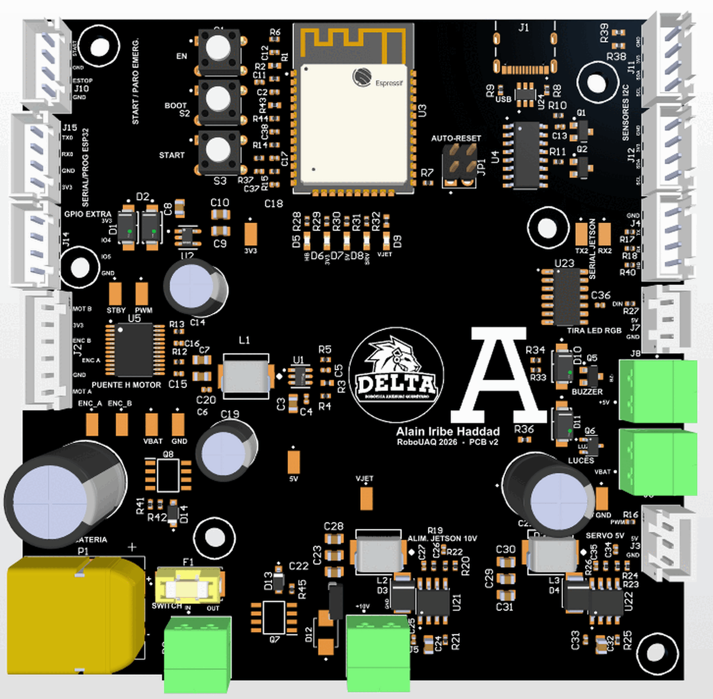

# Resultado final

## Estado al 12 de noviembre de 2026

La placa está en fabricación. Por eso esta página muestra el modelo final y no una fotografía: la foto de la placa ensamblada se agrega aquí en cuanto llegue.

| Fecha | Avance |
|---|---|
| 29 de octubre | Diseño cerrado, DRC en cero, archivos de fabricación generados |
| 30 de octubre a 3 de noviembre | Cotización, dudas del fabricante resueltas y pago del pedido |
| 7 de noviembre | Placas fabricadas y con prueba eléctrica |
| Noviembre | Compra de componentes y ensamblaje en curso |
| Mediados de diciembre | Llegada estimada |

El pedido es de cinco placas, dos de ellas ensambladas con todos los componentes, incluidos los through-hole.

## Cómo va a quedar

En el centro de la placa están el logotipo del equipo DELTA, la "A" de la Anáhuac y el nombre del diseñador, en una zona que se dejó libre de componentes.

## Lo que ya se puede afirmar

- El diseño cumple todas las reglas de fabricación (DRC sin violaciones).
- El fabricante revisó los archivos, aceptó el BOM completo y las placas desnudas pasaron su prueba eléctrica.
- El firmware de prueba compila y el plan de pruebas está escrito.

## Lo que falta comprobar

Nada de lo siguiente está medido todavía:

- Voltajes reales de los cuatro rieles, con y sin carga.
- Estabilidad y rizado de los reguladores de 10 V y del servo.
- Comunicación por UART con la Jetson, que fue la falla principal de la v1.
- Comportamiento térmico con el carro en movimiento.
- Alcance del Bluetooth con la placa montada.

Cuando la placa llegue se seguirá el [plan de pruebas](guia/pruebas.md) y esta página se actualiza con fotos, la tabla de mediciones y las correcciones que hagan falta.

## Carro donde se va a montar

La placa sustituye a la v1 en el carro a escala 1:10 del equipo, junto a la Jetson Orin Nano y las dos cámaras. El soporte se fabrica a partir del [plano mecánico](../hardware/Plano_PCB_Autonomo_V2_soporte.pdf).
