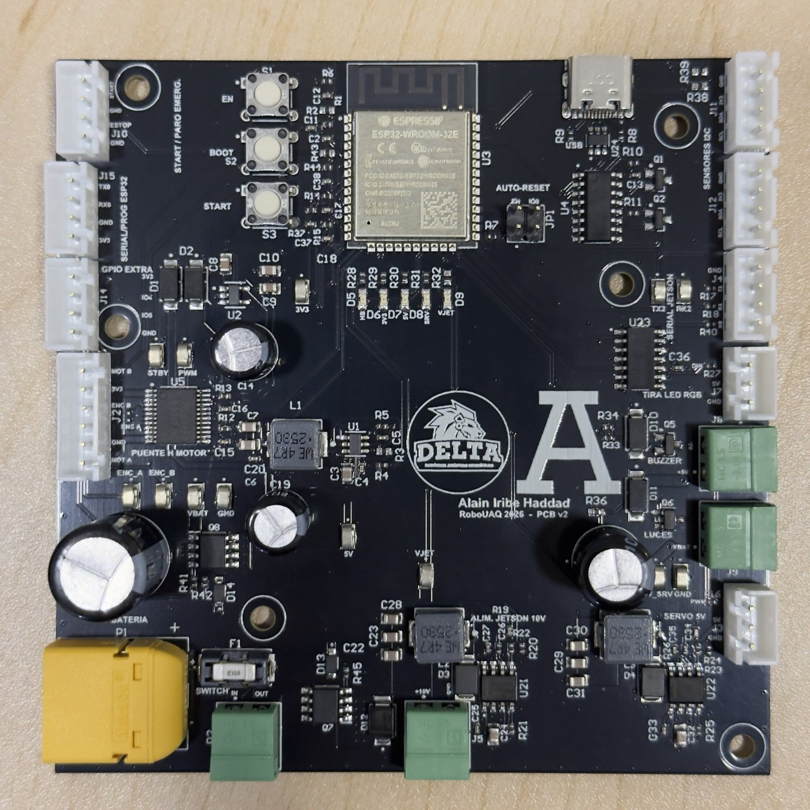
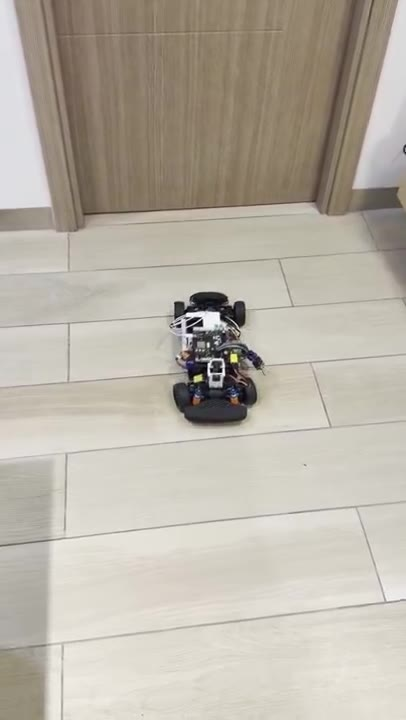
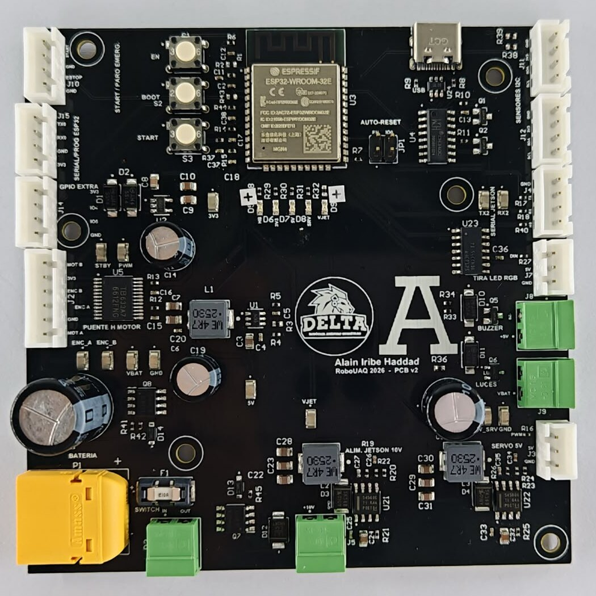

# Resultado final

## La placa terminada (23 de noviembre de 2026)

La placa llegó antes de lo previsto, con todo soldado. La primera prueba se hizo solo con el cable USB-C, sin batería, usando el programa `firmware/prueba-usb`:

- El ESP32 arranca y corre el programa.
- El convertidor USB (CH340C) pasa datos en los dos sentidos. La placa manda un mensaje por segundo y regresa lo que se le escribe.
- El regulador de 3.3 V funciona (LED 3V3 encendido).
- Los botones EN, BOOT y START responden, y el LED HB lo controla el programa.
- El ESP32 se programa entrando a mano al modo de carga (BOOT y EN), sin los jumpers de JP1.

Las soldaduras through-hole se revisaron por la cara inferior: no hay puentes ni pines sin soldar. Las cuatro patas del casco del USB-C quedaron sin soldadura. No afecta lo eléctrico y, según la revisión del profesor, el conector queda bien sujeto así, por lo que no se refuerza.

## Prueba con batería (25 de noviembre de 2026)

Con la batería LiPo 3S cargada y balanceada (4.14 V por celda) y la placa ya montada en el carro, se encendió con el interruptor en P2 y un puente en el lazo del paro (J10, pines 3 y 4). Prendieron los cuatro LEDs de los rieles y nada se calentó.

**Tabla 1.** Voltajes medidos con multímetro.

| Riel | Dónde se midió | Medido | Diseño |
|---|---|---|---|
| Batería (VBAT) | Test point VBAT | 12.4 V | 11.1–12.6 V |
| 3.3 V | Test point 3V3 | 3.3 V | 3.3 V |
| 5 V lógica | Test point 5V | 5.0 V | 5.0 V |
| Servo | J3, pin 2 | 5.04 V | ≈ 5.2 V |
| Jetson | J5, pin 1 | 9.8 V | 10 V (la Jetson acepta de 9 a 20 V) |

Después se cargó el programa `firmware/demo-recorrido`, que al presionar START hace un recorrido corto (acelera, sigue recto, gira a la izquierda, gira a la derecha y vuelve a recto) y se detiene con BOOT o al abrir el paro. Se probó con las ruedas al aire y en el piso:

- El puente H mueve el motor a cualquier velocidad, desde cero hasta el PWM máximo. La falla de STBY de la v1 ya no aparece.
- El servo llega a sus topes calibrados (1190, 1360 y 1730 µs) con su riel propio, sin reiniciar al ESP32.
- START, BOOT y el paro por hardware detienen y arrancan el carro como se diseñó.
- El encoder cuenta de forma estable durante todo el recorrido.
- Con más de 10 minutos encendida y dos corridas, los reguladores y el puente H siguen fríos al tacto.
- La programación con los dos jumpers de JP1 entra sola a modo de carga.

El carro avanza lento aun con el PWM al máximo. La lectura del encoder indica que el motor de tracción gira muy por debajo de lo esperado para su voltaje; tiene varios años de uso y el equipo lo va a sustituir. No es un problema de la placa.

## Prueba con la Jetson: control remoto y cámaras (26 de noviembre de 2026)

Esta es la prueba que pide el curso: la placa moviendo el carro con un control remoto, con la imagen de la cámara a la vista desde otra computadora.

<video controls playsinline width="360" poster="https://patoiribe10-sys.github.io/autonomo-v2-pcb/assets/img/prueba-control-remoto.jpg" src="https://patoiribe10-sys.github.io/autonomo-v2-pcb/assets/video/prueba-control-remoto.mp4"></video>

**Video 1.** El carro manejado en el piso con el control de Xbox, alimentado solo con su batería. Si el video no se reproduce, se puede [descargar aquí](../assets/video/prueba-control-remoto.mp4).

### Cómo quedó conectado

- **Energía:** todo sale de la batería 3S a través de la placa. La Jetson Orin Nano se alimenta por J5 con los 10 V del regulador U21; el servo y el motor, por sus rieles propios.
- **Jetson → ESP32:** cable USB de la Jetson a J1. El convertidor CH340C de la placa aparece en la Jetson como `/dev/esp32`.
- **Control → Jetson:** control de Xbox por Bluetooth.
- **Jetson → laptop:** página web por WiFi en el puerto 8080, con la cámara, el estado del carro y el voltaje de la batería.

El código de la Jetson está copiado en [`jetson/demo-control-remoto/`](../jetson/demo-control-remoto/) y el firmware del ESP32 es [`firmware/carro-v2`](../firmware/carro-v2).

### Qué hace cada parte

El ESP32 corre `carro-v2`. Recibe por el USB líneas como `V30,S-50` (velocidad y dirección de −100 a 100) y responde 20 veces por segundo con la velocidad del encoder, la posición del servo, el voltaje de la batería y su estado. El firmware se encarga solo de las protecciones: si en 300 ms no le llega nada, frena; con batería baja limita la velocidad y suena el buzzer; y el servo nunca sale del rango 1190–1680 µs.

En la Jetson corren cuatro programas de ROS 2: uno lee el control, otro lo convierte en comandos (con LB como "hombre muerto": si se suelta, el carro frena), otro habla con el ESP32 y el último sirve la página de las cámaras. Un servicio de Linux los arranca solos al prender la Jetson, así que basta con encender el interruptor de la placa.

### Resultados

**Tabla 3.** Resultados de la prueba.

| Qué se revisó | Resultado |
|---|---|
| Subir el firmware desde la Jetson (`pio run -e jetson -t upload`) | Correcto, con los jumpers de JP1 y sin tocar botones |
| Comunicación Jetson ↔ ESP32 por USB | Telemetría estable a 20 Hz; ida y vuelta de un mensaje en ~24 ms |
| Lectura de batería en la placa | 12.5–12.7 V en la página con la batería cargada |
| Jetson alimentada desde J5 | Arranca y trabaja con la batería sin reiniciarse |
| Arranque automático | Con el interruptor de la placa, en menos de un minuto ya responden la página y el control, sin monitor ni teclado |
| Control de Xbox | 10 de 10 comprobaciones: avanza, reversa, gira a los dos lados, turbo, y frena al soltar LB |
| Tiempo de respuesta | ~0.1 s desde el control hasta que el servo empieza a moverse |
| Cámara de carriles, ojo de pez (cam0) | Se ve en la página a 10 cuadros por segundo, 640 × 360 |
| Carga de la Jetson | ~23 % de CPU, ~6.2 W y 48–50 °C con todo corriendo |

El servo ya no se fuerza en el tope derecho: se ajustó a 1680 µs porque en 1730 sonaba forzado.

### Lo que quedó pendiente

- **Segunda cámara (cam1):** la Jetson no la detecta (no responde por I2C). Es un problema del cable o del conector, no de la placa; mientras tanto la página la muestra en negro y la otra cámara sigue funcionando.
- **Video por internet:** en la red de la casa la página va fluida; por Tailscale, desde fuera de la red, se pone lenta.
- **WiFi y Bluetooth:** en la Jetson comparten antena, y con el video transmitiéndose el control responde un poco más lento. Se puede resolver con un adaptador Bluetooth USB aparte.

## Estado al 16 de noviembre de 2026

La placa ya existe. Está en la línea de ensamblaje de PCBWay con los componentes de montaje superficial soldados y los through-hole colocados. El 16 de noviembre el ensamblador mandó fotos para confirmar la orientación de las piezas con polaridad antes de terminar de soldar, recortar terminales y limpiar.

| Fecha | Avance |
|---|---|
| 29 de octubre | Diseño cerrado, DRC en cero, archivos de fabricación generados |
| 30 de octubre a 3 de noviembre | Cotización, dudas del fabricante resueltas y pago del pedido |
| 7 de noviembre | Placas fabricadas y con prueba eléctrica |
| 16 de noviembre | Componentes montados; fotos de revisión y orientación confirmada |
| 23 de noviembre | Placa recibida; primera prueba por USB sin batería |
| 25 de noviembre | Prueba con batería: rieles medidos, motor, servo y paro funcionando en el carro |

El pedido es de cinco placas, dos de ellas ensambladas con todos los componentes, incluidos los through-hole.

## Del modelo a la placa

 junto al modelo 3D de Altium (derecha), en la misma orientación.")

La placa salió igual al modelo: mismas posiciones, misma serigrafía y los conectores viendo hacia afuera. En el centro quedaron el logotipo del equipo DELTA, la "A" de la Anáhuac y el nombre del diseñador, sin piezas encima.

## Acercamientos

 con su inductor, su diodo y la bornera J5.")

 junto al conector J3. Derecha: regulador de 5 V de la lógica (U1).")

, con los diodos D1 y D2 y el regulador de 3.3 V (U2) arriba. Derecha: buffer de 5 V (U23) y las salidas de buzzer y luces.")

. Derecha: módulo ESP32 y los cinco LEDs indicadores. Las etiquetas con el signo + las puso el ensamblador para preguntar por la polaridad.")

## Revisión de orientación

Las fotos se compararon contra el archivo de la PCB: para cada pieza con polaridad se tomó de qué lado queda cada red en el diseño y se buscó la marca correspondiente en la fotografía.

**Tabla 2.** Resultado de la revisión visual.

| Piezas | Qué se revisó | Resultado |
|---|---|---|
| C1, C14, C19, C21 | Franja del negativo del lado de GND | Correcto en los cuatro |
| D1, D2, D10, D11 (SS14) | Banda del cátodo | Correcto |
| D3, D4 (SK56B) | Banda del cátodo hacia el inductor | Correcto |
| D12 (TVS) | Banda del cátodo hacia el borde de la placa | Correcto |
| D13, D14 (zener) | Banda del cátodo hacia VBAT | Correcto (D13 con una foto adicional del ensamblador) |
| U1, U4, U5, U21, U22, U23, U24 | Marca del pin 1 | Correcto |
| Q7, Q8 | Marca del pin 1 | Correcto |
| Conectores JST y borneras | Sentido contra el modelo 3D | Correcto |
| D5 a D9 (LEDs) | Los cinco van en el mismo sentido | La marca del cátodo no se distingue en la foto |

Al ensamblador se le confirmó que continuara. En los LEDs se le dejó por escrito la regla: el ánodo va del lado de las resistencias R28 a R32. D13 se confirmó después con una foto de cerca que mandaron, con el cátodo del lado del punto blanco.

Es una revisión de fotos. Sirve para descartar piezas al revés, no para saber si la placa funciona.

## Lo que ya se puede afirmar

- El diseño cumple todas las reglas de fabricación (DRC sin violaciones).
- El fabricante aceptó los archivos y el BOM completo, y las placas desnudas pasaron su prueba eléctrica.
- La placa ensamblada coincide con el modelo y las piezas con polaridad que se ven en las fotos están bien orientadas.
- El firmware de prueba compila y el plan de pruebas está escrito.
- La parte lógica funciona con USB: ESP32, convertidor USB, regulador de 3.3 V, botones y LED HB.
- Los cuatro reguladores dan el voltaje de diseño con la batería y no se calientan.
- El puente H, el servo, el encoder y el paro por hardware funcionan con la placa montada en el carro.
- La placa alimenta a la Jetson por J5 y se comunica con ella por USB, que era la falla principal de la v1. El carro se maneja con un control de Xbox viendo la cámara desde una laptop.

## Lo que falta comprobar

- Estabilidad y rizado de los reguladores de 10 V y del servo con osciloscopio.
- Voltajes con la Jetson y el servo trabajando al mismo tiempo.
- Comportamiento térmico en recorridos largos.
- Alcance del Bluetooth con la placa montada.

Se sigue el [plan de pruebas](guia/pruebas.md) y esta página se actualiza con cada resultado.

## Carro donde se va a montar

La placa ya sustituyó a la v1 en el carro a escala 1:10 del equipo, junto a la Jetson Orin Nano y las dos cámaras. El soporte se fabrica a partir del [plano mecánico](../hardware/Plano_PCB_Autonomo_V2_soporte.pdf).
