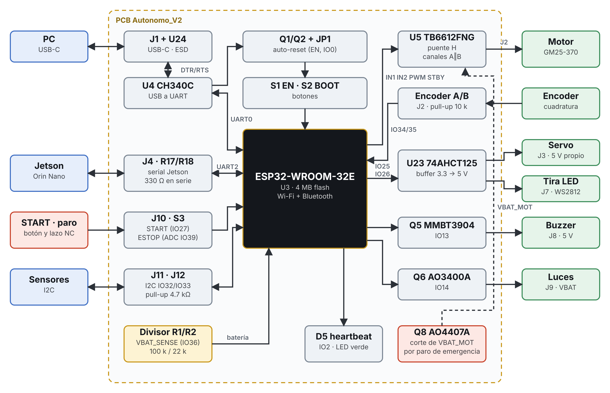

# Funcionamiento del sistema

Todo gira alrededor del ESP32 (U3). A la izquierda de la figura están las entradas y los enlaces de comunicación; a la derecha, lo que la placa mueve o enciende.

## De una orden a las llantas

1. La Jetson manda por el conector J4 una línea con el formato `V<vel>,S<dir>`. Las resistencias R17 y R18 (330 Ω) protegen los pines de los dos lados.
2. El ESP32 la recibe por UART2 (IO16) y separa velocidad y dirección.
3. Para la velocidad escribe la dirección de giro en IN1 e IN2 (IO21, IO22) y el ciclo de trabajo en PWM (IO23). El TB6612FNG (U5) conmuta la batería hacia el motor.
4. El encoder del motor regresa dos señales desfasadas por J2. El ESP32 las cuenta por interrupción en IO34 e IO35 y con eso sabe cuánto avanzó la llanta.
5. Para la dirección genera un pulso de 50 Hz en IO25. El buffer 74AHCT125 (U23) lo sube de 3.3 V a 5 V antes de mandarlo al servo.
6. La velocidad medida regresa a la Jetson por IO17 con el formato `v…,s…`.

## Encendido

1. Se conecta la batería en P1 y se cierra el interruptor de P2.
2. Q7 deja pasar la corriente solo si la polaridad es correcta. Aparece VBAT y arrancan los tres reguladores conmutados.
3. Se prenden los LEDs de riel: 3V3, 5V, SRV y VJET. Si alguno falta, ese regulador no arrancó.
4. El ESP32 inicia su programa y el LED HB empieza a parpadear.
5. La Jetson arranca con los 10 V de J5.

## Paro de emergencia

El motor no se alimenta directo de VBAT sino de VBAT_MOT, que pasa por el MOSFET Q8. La compuerta de Q8 está conectada al pin 3 de J10. Mientras ese pin esté unido a GND (pin 4) a través del botón de paro, que es normalmente cerrado, Q8 conduce. Al oprimir el paro o si el cable se desconecta, la compuerta sube a VBAT por R41 y Q8 se abre: el puente H se queda sin energía.

Es un corte por hardware. El ESP32 solo se entera, leyendo el voltaje de la compuerta con un divisor (IO39), para avisarle a la Jetson. El servo y la Jetson siguen encendidos, así el carro conserva la dirección y no pierde el estado del programa.

## Supervisión

- **Batería.** Un divisor de 100 kΩ y 22 kΩ lleva VBAT a IO36. El voltaje real es la lectura multiplicada por 5.545. Con eso el firmware puede sonar el buzzer cuando la batería baja.
- **Heartbeat.** El LED D5 parpadea desde IO2 mientras el programa corre.
- **Línea HB.** El pin 4 de J4 (IO18) queda disponible para que la Jetson y el ESP32 se avisen que siguen vivos.

## Programación

La computadora se conecta por USB-C. El CH340C (U4) convierte USB a serial y, con los transistores Q1 y Q2, usa las líneas DTR y RTS para poner al ESP32 en modo de carga sin tocar botones. Los botones EN (S1) y BOOT (S2) están por si hace falta hacerlo a mano. El paso a paso está en [Programar el ESP32](../guia/programar.md).
