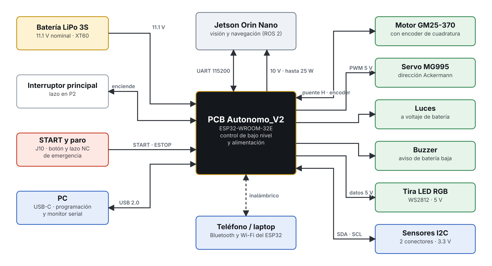

# Diagrama Top-Level

El carro tiene dos cerebros. La Jetson Orin Nano ve la pista con dos cámaras y decide a dónde ir. La PCB Autonomo_V2 hace el trabajo de bajo nivel: reparte la energía de la batería y convierte cada orden de la Jetson en movimiento del motor y del servo.

## Qué entra y qué sale de la placa

**Tabla 1.** Interfaces externas de la PCB.

| Elemento externo | Conector | Qué viaja por ahí | Sentido |
|---|---|---|---|
| Batería LiPo 3S | P1 (XT60) | 11.1 V nominales, hasta unos 9 A de pico | Entra |
| Interruptor principal | P2 | Lazo en serie con la batería. Abierto, la placa queda apagada | Lazo |
| Jetson Orin Nano (energía) | J5 | 10 V, hasta 25 W | Sale |
| Jetson Orin Nano (datos) | J4 | UART a 115200 baudios, 3.3 V | Ambos |
| Motor con encoder | J2 | Salida del puente H y canales A/B del encoder | Ambos |
| Servo de dirección | J3 | 5 V y señal PWM a 5 V | Sale |
| Luces | J9 | Voltaje de batería conmutado | Sale |
| Buzzer | J8 | 5 V conmutados | Sale |
| Tira LED RGB | J7 | 5 V y datos WS2812 | Sale |
| Botón START y paro de emergencia | J10 | Botón a GND y lazo normalmente cerrado | Entra |
| Sensores I2C | J11, J12 | 3.3 V, SDA y SCL | Ambos |
| Computadora | J1 (USB-C) | Programación y monitor serial | Ambos |
| Teléfono o laptop | Antena del ESP32 | Bluetooth y Wi-Fi | Ambos |

## Reparto de tareas

| | Jetson Orin Nano | PCB Autonomo_V2 |
|---|---|---|
| Función | Visión, detección de señales y navegación | Motor, dirección, energía y seguridad |
| Software | ROS 2 Humble sobre Ubuntu 22.04 | Firmware en C++ (PlatformIO, framework Arduino) |
| Tiempos | Decenas de milisegundos por cuadro | Lazo de control y lectura del encoder por interrupción |
| Si falla | El carro deja de recibir órdenes | El paro de emergencia corta el motor sin pasar por software |

La separación tiene una razón práctica. Si la Jetson se cuelga o se reinicia por batería baja, el ESP32 sigue vivo y puede frenar. Y el paro de emergencia actúa sobre un MOSFET, así que funciona aunque los dos procesadores estén trabados.

## Protocolo entre la Jetson y la placa

Es texto plano por UART, una línea por mensaje:

| Mensaje | Sentido | Significado |
|---|---|---|
| `V<vel>,S<dir>\n` | Jetson → ESP32 | Velocidad y dirección deseadas |
| `v<vel>,s<dir>\n` | ESP32 → Jetson | Velocidad medida con el encoder y dirección aplicada |

Los detalles del cable están en [Conectividad](../hardware/conectividad.md).
